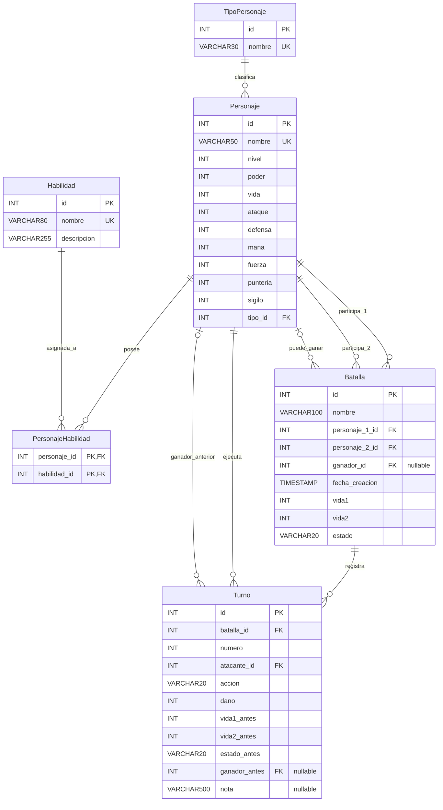

# Combate por API

API Minimal .NET 10 para administrar personajes, combates y turnos. Las lecturas usan la conexión de invitado y las escrituras la conexión de administrador.

## Base de datos

La API actual se conecta al esquema legado `5to_combate_morena`, que usa las tablas `Personaje`, `TipoPersonaje` y `Batalla`. Antes de iniciar la API sobre una base existente, ejecutar la migración aditiva `scripts/04_api_turnos.sql` con una cuenta que pueda alterar y actualizar tablas y crear tablas. La migración no elimina personajes ni combates; agrega el estado y las vidas del combate y crea `Turno`. Si se usa el instalador completo, `scripts/install.sql` ya carga la migración, pero `scripts/script1.sql` elimina y recrea la base: respaldarla primero.

Para preparar la base desde cero, ejecutar desde la raíz en este orden:

```sh
mysql -u root -p < sql/01_estructura.sql
mysql -u root -p < sql/02_usuarios.sql
mysql -u root -p < sql/03_datos_muestra.sql
```

Para la base legado que ya está cargada en este repositorio, la migración se ejecuta así. Detecta las columnas que ya se hayan agregado en un intento anterior; ejecutarla con una cuenta que también tenga permisos `UPDATE` y `CREATE`:

```sh
mysql -u administrador -p 5to_combate_morena < scripts/04_api_turnos.sql
```

Antes de ejecutar `02_usuarios.sql`, cambiar ambos valores de ejemplo por contraseñas propias. No guardar contraseñas reales en el repositorio. El usuario invitado tiene `SELECT` sobre toda la base; el administrador tiene permisos completos. Para la base legado, `scripts/USUARIOS.SQL` crea `invitado` y `administrador`.

Configurar las cadenas de conexión como variables de entorno (ejemplo para Bash):

```sh
export COMBATE_API_READ_CONNECTION='Server=localhost;Database=5to_combate_morena;User ID=invitado;Password=...'
export COMBATE_API_ADMIN_CONNECTION='Server=localhost;Database=5to_combate_morena;User ID=administrador;Password=...'
export COMBATE_API_CORS_ORIGINS='http://localhost:5173,http://localhost:3000'
```

`COMBATE_API_CORS_ORIGINS` acepta una lista separada por comas de orígenes completos (esquema, host y puerto). Solo esos orígenes reciben permisos CORS; si la variable no está configurada, no se habilita acceso cross-origin. En producción, reemplazar los ejemplos locales por el origen real del frontend.

La API también carga `src/API/appsettings.json` y, al ejecutar en entorno `Development`, `src/API/appsettings.Development.json`. Este último habilita CORS para `http://localhost:5173` y `http://localhost:3000`; `COMBATE_API_CORS_ORIGINS` puede sobrescribir esa lista. No guardar contraseñas en estos archivos.

## Ejecutar

```sh
dotnet build src/Proyecto.sln
dotnet test src/Tests/Tests.csproj
dotnet run --project src/API/API.csproj
```

Swagger ya está instalado mediante `Swashbuckle.AspNetCore` y se publica en `/swagger` en la URL que informa `dotnet run` (por ejemplo, `http://localhost:5093/swagger`). La especificación JSON se sirve en `/swagger/v1/swagger.json`.

## Endpoints

| Método | Ruta | Uso |
|---|---|---|
| GET | `/api/personajes` | Listar personajes |
| GET | `/api/personajes/{id}` | Obtener personaje |
| GET | `/api/personajes/{id}/combates` | Historial de combates |
| POST | `/api/personajes` | Crear personaje: `{"nombre":"Gimli","tipo":"Guerrero"}` |
| PUT | `/api/personajes/{id}` | Cambiar nombre: `{"nombre":"Gimli"}` |
| DELETE | `/api/personajes/{id}` | Eliminar si no participó en combates |
| GET | `/api/combates` | Listar combates |
| POST | `/api/combates` | Crear: `{"personaje1Id":1,"personaje2Id":2}` |
| GET | `/api/combates/{id}` | Detalle, turnos y resultado |
| PUT | `/api/combates/{id}` | Cambiar participantes antes de turnos |
| DELETE | `/api/combates/{id}` | Eliminar si no tiene turnos |
| GET | `/api/combates/{id}/turnos` | Listar turnos |
| POST | `/api/combates/{id}/turnos` | Ejecutar: `{"atacanteId":1,"accion":"atacar"}` |
| PUT | `/api/combates/{id}/turnos/{turnoId}` | Editar nota: `{"nota":"Golpe decisivo"}` |
| DELETE | `/api/combates/{id}/turnos/{turnoId}` | Eliminar último turno y restaurar estado |

Los turnos y la actualización del combate se guardan en una transacción. El borrado del último turno también elimina el registro y restaura el snapshot del combate dentro de una transacción.

## Diagrama entidad-relación

Este diagrama representa el esquema legado `5to_combate_morena` después de ejecutar `scripts/04_api_turnos.sql`.



## Documentación

- [Guía de instalación y uso](docs/guia-de-uso.md)